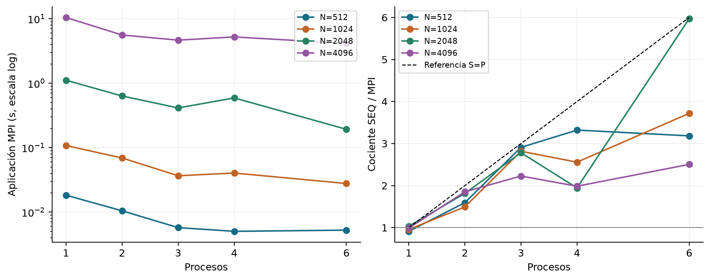
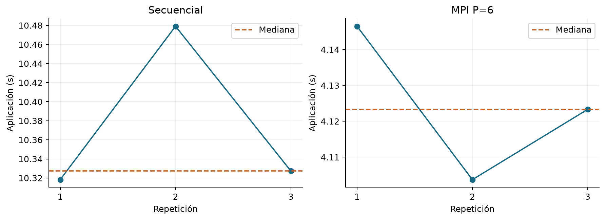
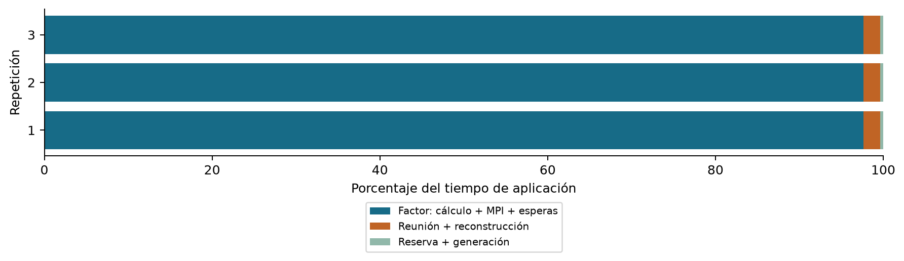
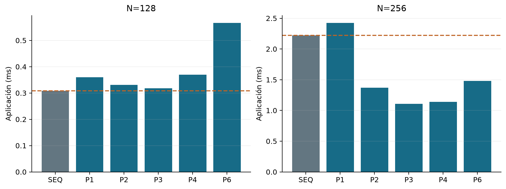

# Etapa 15: primeros resultados del clúster

Cholesky en C y MPI | Experimentos del 28/09/2026. Edición revisada con archivos originales del clúster. Continuación de las catorce etapas locales. Estado: exploración completada; campaña formal de cruce no incluida en la evidencia recibida.

## Pregunta y respuesta provisional

¿El candidato conserva corrección y obtiene ganancias en el nuevo entorno? Las ejecuciones documentadas pasan validación. El control repetido de N=4096 muestra un cociente de medianas de aproximadamente 2,50 frente al secuencial. El escaneo sugiere un cruce entre N=128 y N=256 y un comportamiento no monótono con P. Todavía no hay una curva de escalabilidad confirmada con repeticiones para cada configuración.

## Qué evidencia recibimos

| Conjunto | Ejecuciones descritas | Uso |
| --- | --- | --- |
| Validación N=128 | 2 | Corrección secuencial y MPI P6 |
| Piloto N=512..4096 | 8 | Elegir tamaños |
| Control N=4096 | 6 (3 por método) | Dispersión dentro de la sesión |
| Escaneo mayor y pequeño | 24 + 12 | Localizar preguntas |
| Diagnóstico de cuota | 1 | Comprobar throttling |
| Campaña formal de cruce | 0; 240 previstas | Plan, sin resultados todavía |

Se recibieron 53 CSV originales, sus 53 archivos de error, dos logs de compilación, cinco fuentes y un manifiesto SHA-256 en evidencia_preformal_20260928.tar.gz. Los 113 hashes del manifiesto coinciden. Los gráficos y las estadísticas de esta edición se recalculan desde los CSV originales, manteniendo separados los conjuntos. Las 50 observaciones de las tablas anteriores coinciden salvo redondeo; las conclusiones se mantienen.

## Continuidad del proyecto

Conservamos right-looking, vector local, reparto cíclico 1D b=1, generación distribuida y L en rango 0. Los cinco SHA-256 de la bitácora coinciden con las fuentes actuales, cuya copia queda archivada con este análisis. No se cambiaron los algoritmos. Las decisiones previas explican el candidato; los tiempos de WSL no se usan para calcular ganancias en el clúster.

# Entorno, corrección y significado de los relojes

La sesión declara AMD EPYC 7B12, GCC 13.3 y Open MPI 4.1.6. Ve 128 CPUs y dos nodos NUMA. cpu.max=600000 100000 limita la capacidad agregada a seis CPUs equivalentes; memory.max=25769803776 corresponde a 24 GiB. Esto no acredita exclusividad sobre seis núcleos.

## Pregunta: ¿se preservó la corrección?

| N=128 | Secuencial | MPI P=6 |
| --- | --- | --- |
| Residuo proyectado | 3,8964e-16 | 3,8964e-16 |
| Residuo completo | 3,7903e-16 | 3,7903e-16 |
| valid | 1 | 1 |

El máximo residuo proyectado informado en los tamaños explorados es 2,274918e-15, unas 440 veces menor que 1e-12. Para N>128, exact_residual=-1 indica que no se calculó el residuo completo. Ocho proyecciones son evidencia numérica, no una prueba exhaustiva. Residuos iguales no demuestran que los factores sean idénticos elemento a elemento. El alcance es la familia SPD diagonalmente dominante generada con semilla 2026.

## Contrato comprobado en main_candidate.c

| Campo | Interpretación |
| --- | --- |
| application_s | Rango 0: reserva + generación + factor + reunión/reconstrucción. Excluye validación y arranque/cierre MPI. |
| factor_s | Tiempo de la fase de factor en rango 0; incluye MPI y esperas, no solo operaciones aritméticas. |
| gather_s | MPI_Gatherv y reconstrucción serial de L en rango 0; no es tiempo puro de red. |
| max_local_s | Máximo del intervalo local completo entre rangos; no son máximos por fase. |
| validation_s | Comprobación posterior al tiempo de aplicación. No sustituye una medición externa. |

Las fases consecutivas suman el total en cada ejecución. Debe resumirse application_s directamente: sumar medianas de fases no reconstruye necesariamente su mediana. Se verificó la suma en los 53 CSV originales dentro de su precisión impresa, además de tiempos finitos y no negativos, valid=1 y residuos dentro del criterio.

## Conclusión y próxima pregunta

El traslado tiene evidencia de corrección para las entradas ensayadas. Falta medir de manera repetida cuánto cuesta producir L bajo una afinidad controlada y cuánto tarda el comando completo.

# Escaneo mayor: dónde aparecen las preguntas

Figura 1. Sección 14 de la bitácora: una observación por configuración, sin barras de dispersión. Las líneas conectan puntos medidos; no describen tamaños ni procesos intermedios. El secuencial de este escaneo no tenía afinidad fijada.

| N | SEQ (s) | P del mínimo MPI | MPI (s) | SEQ/MPI |
| --- | --- | --- | --- | --- |
| 512 | 0.016721 | 4 | 0.005035 | 3.32 |
| 1024 | 0.103386 | 6 | 0.027800 | 3.72 |
| 2048 | 1.151211 | 6 | 0.192791 | 5.97 |
| 4096 | 10.390189 | 6 | 4.148838 | 2.50 |

## Observaciones que merecen confirmación

Para N=2048, P=4 tarda 43,1% más que P=3; pasar de P=4 a P=6 reduce el tiempo 67,4%. En N=4096, P=4 también empeora frente a P=3. P=6 produce el menor tiempo observado en tres de los cuatro tamaños, mientras N=512 favorece P=4. Son mínimos seleccionados de observaciones únicas, no recomendaciones definitivas.

Al duplicar N de 2048 a 4096, el total secuencial crece 9,03 veces y MPI P=6 crece 21,52 veces dentro de este escaneo. El total contiene varias fases: no debe exigirse un factor ocho exacto. La diferencia justifica estudiar ambos tamaños; no demuestra por sí misma un problema de caché, NUMA, comunicación o cuota.

## Cómo leer el resultado cercano a seis

N=2048/P=6 da 5,97 en el escaneo y 6,15 en el piloto separado. Se conservan ambos sin combinarlos. El cociente es aceleración frente al secuencial propio, que usa otra ruta de almacenamiento; no prueba escalabilidad lineal o superlineal sostenida. Comparar MPI P1/MPIP responde una pregunta distinta y también deberá informarse.

# N=4096: qué dicen las tres repeticiones

Figura 2. Tres pares consecutivos de la sección 13, con SEQ antes de MPI en todos ellos. Paneles con escalas verticales distintas para mostrar variación. Son repeticiones de una misma sesión, con el secuencial sin afinidad explícita.

| Estadística (s) | SEQ | MPI P=6 |
| --- | --- | --- |
| Mediana | 10.327355 | 4.123326 |
| Mínimo | 10.318244 | 4.103728 |
| Máximo | 10.479087 | 4.146479 |
| Q1 inclusivo | 10.322799 | 4.113527 |
| Q3 inclusivo | 10.403221 | 4.134902 |
| Desvío muestral | 0.090348 | 0.021400 |

Cociente de medianas: 2.5046. Reducción relativa del tiempo: 60.07%. Eficiencia descriptiva S/6: 41.74%. Coeficiente de variación: SEQ 0.87% y MPI 0.52%. Q1 y Q3 se calculan con interpolación inclusiva; con tres datos su utilidad es descriptiva, sin inferencia de significación.

## Conclusión respaldada

El tiempo MPI cercano a 4,12 s reaparece en los tres pares. No parece un valor aislado del primer piloto. La ganancia alrededor de 2,50 se sostiene en este control, pero no acredita estabilidad entre sesiones ni una configuración óptima. No se añaden el piloto, el escaneo o el diagnóstico de cuota a esta muestra para aumentar artificialmente n.

## Siguiente pregunta

¿Se mantienen la ganancia y la no monotonía al fijar también el secuencial, rotar métodos y repetir P=1,2,3,4,6? Esa prueba es más informativa que aumentar ahora el número de variantes algorítmicas.

# Fases, afinidad y cuota: evidencia y límites

Figura 3. Porcentajes calculados por ejecución desde los CSV originales de los tres controles MPI; el resto se obtiene como application-factor-gather y corresponde a reserva más generación.

Mediana de la fracción de factor: 97.64%; reunión/reconstrucción: 1.99%. El mayor tiempo está dentro del kernel MPI, pero esta medición no separa cálculo, difusión y espera. Optimizar únicamente la reunión tendría un margen cercano al 2% del total en estos casos, aun suponiendo eliminarla por completo.

## Afinidad observada, no exclusividad

El diagnóstico con /bin/true y P=6 informó seis cores distintos del socket 0. Es evidencia del mapeo de ese lanzamiento. No demuestra retrospectivamente el binding de cada benchmark ni que P=4 use exactamente la misma colocación. Compartir socket tampoco demuestra ubicación efectiva de páginas de memoria. Conviene guardar bindings por P en la campaña formal.

## Throttling comprobado, causalidad abierta

| Contador | Incremento |
| --- | --- |
| usage_usec | 37.260.596 (37,261 CPU-s agregados) |
| nr_periods | 66 |
| nr_throttled | 28 (42,42% de los períodos observados) |
| throttled_usec | 119.281 (0,119281 s del contador) |

Los contadores cubren el intervalo entre dos lecturas del cgroup, incluidos lanzamiento, validación y procesos auxiliares; application_s=4,127776 s solo cubre la aplicación en rango 0. El 42,42% NO es porcentaje de tiempo perdido. Tampoco corresponde restar 0,119281 s al factor ni dividir los CPU-s por application_s para inferir utilización. No hay un control equivalente sin cuota que permita atribuirle la pérdida de rendimiento.

## Decisión

Mantener P<=6 y registrar cuota/contadores sin modificar el algoritmo. La evidencia todavía no permite escoger entre cuota, interferencia, localidad y colectivas como causa de la no monotonía.

# Cruce pequeño: hipótesis y campaña pendiente

Figura 4. Sección 17: una observación por método, con SEQ fijado a CPU0. No se combina con el escaneo mayor ni con las validaciones anteriores.

## Qué se puede concluir ahora

En N=128 todos los tiempos MPI superan el secuencial de esa prueba. En N=256, P=2,3,4,6 mejoran; el menor tiempo observado es P=3, con cociente 2,01. Esto localiza una región de interés entre dos tamaños ensayados. No demuestra que exista un único umbral ni que todos los tamaños posteriores mejoren.

## Protocolo que ya quedó definido

N=128,160,192,224,256; SEQ y MPI P=1,2,3,4,6; una ronda descartada y siete rondas medidas. Son 30 configuraciones, 240 lanzamientos y 210 observaciones útiles. Se rota el orden de métodos; el orden de tamaños permanece fijo. Siete rondas no equilibran exactamente las seis posiciones posibles. Cada observación abre un proceso nuevo: la ronda descartada no convierte al programa en un benchmark de runtime persistente.

Métrica primaria: application_s. S=mediana(SEQ)/mediana(MPI); E=S/P. Mejora clara descriptiva si S>1,10 y Q3(MPI)<Q1(SEQ). Fijar Q1/Q3 inclusivos antes del análisis. No es un test estadístico, y comparar muchas configuraciones hace especialmente necesaria una confirmación posterior de los puntos elegidos.

## Ajustes operativos antes de ejecutarla

Usar una carpeta nueva y fallar si ya existe: mkdir -p y tee sobre nombres repetidos pueden sobrescribir una campaña. Guardar fuentes/hashes, entorno, bindings, errores y código de salida. Mantener una sola campaña activa. Si ya se ejecutó después de escribir la bitácora, conservarla como fue y analizarla antes de decidir si requiere repetición.

## Pregunta que seguirá abierta

El cruce de application_s no es el cruce del comando completo. Un MPI rápido dentro del programa puede seguir siendo más lento cuando se incluyen arranque, validación y cierre. Falta medir ese segundo reloj en el clúster.

# Conclusión de etapa y camino al cierre

## Mi evaluación

El avance es productivo: se confirmó el candidato, se identificó el entorno real y los pilotos descubrieron preguntas que una campaña automática podría haber ocultado. Ya hay evidencia suficiente para fijar las siguientes mediciones. Seguir acumulando ejecuciones aisladas aportaría menos que completar una grilla repetida y una confirmación en otra sesión.

## Orden recomendado

| Paso | Pregunta y alcance |
| --- | --- |
| 1. Evidencia resguardada | Completado: paquete original archivado; CSV, archivos de error, logs y fuentes contrastados. No hace falta repetir los pilotos para recuperar esta evidencia. |
| 2. Completar el cruce | Ejecutar o recuperar la campaña N=128..256 fijada. Reportar medianas, Q1-Q3 y criterio descriptivo por N y P. |
| 3. Escalabilidad mayor | N=512,1024,2048,4096; mismos seis métodos; siete repeticiones y una ronda descartada: 192 lanzamientos, 168 útiles. Afinidad controlada y orden rotado. |
| 4. Segundo reloj | Medir aplicación y comando externo en los mismos lanzamientos, tras verificar el cronómetro. Priorizar esta incorporación para la campaña mayor; conservar validación aparte. |
| 5. Confirmar y cerrar | Otra sesión para el cruce y configuraciones decisivas, especialmente N=2048/4096 con P=3,4,6 y SEQ. Explicar límites sin exigir resolver cada causa. |

La grilla mayor es una propuesta para el siguiente bloque, no un resultado ni una orden de ejecución inmediata. Si el costo es alto, hacer primero N=2048 y N=4096 y completar después los otros tamaños. Comparar sesiones por separado y medir el secuencial en cada una. No hace falta ampliar a 48/96 cores para responder el alcance actual.

## Conclusión que hoy puede defenderse

En la sesión con cuota de seis CPUs equivalentes y 24 GiB, el candidato conserva la corrección reportada y muestra ganancias del tiempo hasta L en varios casos explorados. Para N=4096, tres repeticiones por método dan 10,327 s secuenciales y 4,123 s MPI P6 de mediana, con cociente 2,50. No se ha establecido aún el cruce reproducible, la curva completa de escalabilidad ni la ganancia del comando externo. Los resultados corresponden al entorno de un host; no acreditan ejecución entre nodos.

No es necesario que MPI gane siempre para cerrar el proyecto. El cierre requiere describir dónde gana, dónde deja de convenir y qué costo agrega el flujo completo, con datos repetidos y límites explícitos. Bloques, BLAS, OpenMP y distribución 2D quedan como extensiones justificables después de esa respuesta.

# Trazabilidad y precisiones de la revisión

## Qué se verificó y qué permanece declarado

Se auditaron los 53 CSV originales y los 113 hashes del paquete. Las cinco fuentes coinciden byte por byte con las copias archivadas. Los 53 archivos .err y ambos logs de compilación están vacíos: no contienen mensajes capturados, pero no sustituyen códigos de salida explícitos. No se ejecutaron nuevos benchmarks. Los diagnósticos de afinidad y cpu.stat siguen procediendo de la bitácora: el paquete no incluye esos logs completos.

## Precisiones frente a interpretaciones anteriores

1. Coincidencia de residuos no equivale a igualdad de factores. 2. El binding observado para P=6 no descarta de forma general efectos NUMA ni acredita P=4. 3. La repetibilidad en una sesión no demuestra estabilidad entre fechas. 4. La fracción dominante de factor no equivale a cómputo puro. 5. La cuota de seis CPUs no es una reserva exclusiva. 6. El throttling observado no cuantifica la pérdida de tiempo de Cholesky.

## Archivos conservados con esta etapa

| Archivo o carpeta | Contenido |
| --- | --- |
| evidencia_preformal_20260928.tar.gz | Paquete original íntegro del clúster. |
| bitacora_original.md | Contexto y protocolo experimental. |
| fuentes/ y auditoria.json | Fuentes, hashes y comprobaciones actualizadas. |
| observaciones_originales.csv | 53 filas extraídas del paquete original. |
| observaciones_tablas.csv | Reconstrucción anterior conservada para contraste. |
| cocientes_escaneo.csv | Cocientes recalculados con los originales. |
| estadisticas_control.csv | Mediana, cuartiles, desvío y CV del control. |
| fracciones_control.csv | Porcentajes por ejecución desde originales. |
| throttling_transcrito.csv | Contadores de la bitácora; diferencias verificadas. |
| informe.md y cuatro PNG | Análisis y gráficos de esta edición revisada. |

Generador: desde_cero/docs/generar_informe_cluster_exploratorio.py. Verifica el paquete, contrasta la bitácora y recalcula desde los originales. Esta revisión reemplaza la edición que indicaba ausencia de CSV y logs. No añade repeticiones ni convierte los pilotos en una campaña formal. Análisis y documentación realizados con asistencia de IA.
