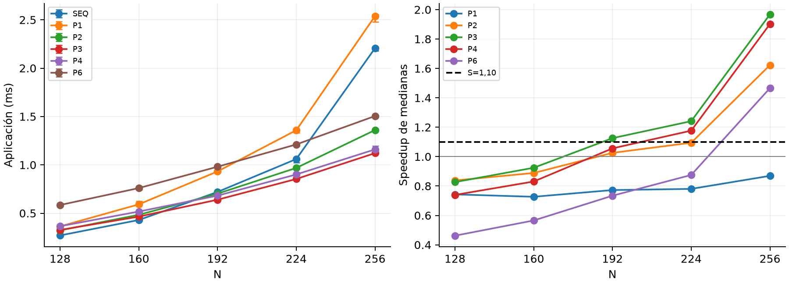
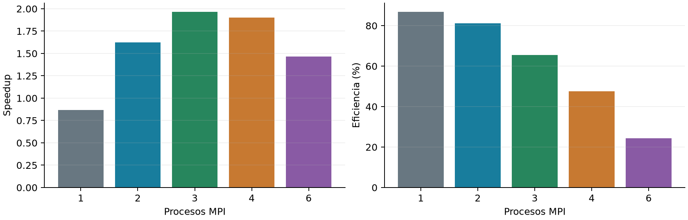
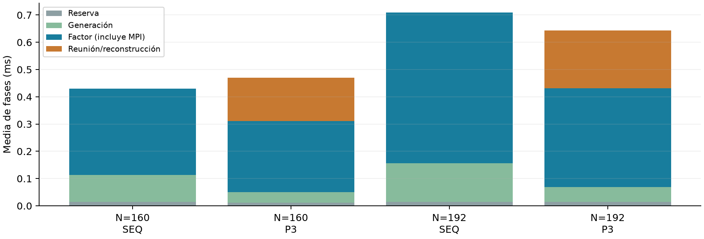

# Etapa 16: campaña formal de cruce

Clúster | 28/09/2026 | Candidato Cholesky right-looking MPI cíclico 1D. Continuación de la exploración de la Etapa 15. Análisis independiente del paquete original entregado por el usuario; los resultados pegados en el mensaje se contrastaron con los CSV.

## Pregunta y resultado

¿En qué tamaños ensayados MPI reduce claramente el tiempo hasta disponer de L frente al secuencial propio? Bajo el criterio prefijado, P=3 presenta la primera mejora en N=192. P=4 la presenta en N=224; P=2 y P=6, en N=256. MPI P=1 no cumple el criterio en la grilla. Son cruces descriptivos de una sesión, no umbrales universales.

| Control de evidencia | Resultado |
| --- | --- |
| Cantidad de muestras | 210 útiles y 30 warmups; siete útiles por cada una de 30 configuraciones. |
| Integridad | 494 archivos regulares; 493 hashes del manifiesto general verificados. El manifiesto no se incluye a sí mismo. |
| Errores y compilación | 240 archivos .err y dos logs de compilación vacíos. No hay códigos de salida explícitos archivados. |
| Corrección numérica | 240 filas con valid=1. Residuo proyectado máximo útil: 5.764e-16. |
| Fuentes | Cinco fuentes idénticas a las de la Etapa 15. Se preservan también los dos ejecutables originales sin ejecutarlos. |

## Protocolo

N=128,160,192,224,256; SEQ y MPI P=1,2,3,4,6. Una ronda descartada y siete medidas. Orden de métodos rotado; tamaños en orden creciente. Afinidad prevista: SEQ con taskset CPU0; MPI --bind-to core --map-by core. El entorno conserva un diagnóstico de binding P6 en el socket 0, no un registro independiente de cada lanzamiento.

AMD EPYC 7B12, GCC 13.3, Open MPI 4.1.6, cuota de seis CPUs equivalentes y 24 GiB. Fuente de entorno fechada 2026-09-28T16:06:20Z. No se interpreta la cuota como seis cores exclusivos ni como acceso a varios nodos.

# Resultado del criterio fijado antes de medir

Figura 1. Medianas y barras Q1-Q3 inclusivos en tiempos, siete observaciones por punto. Los speedups son cocientes de medianas, sin intervalos de confianza. Las líneas unen únicamente los puntos medidos. Warmups y pilotos quedan excluidos.

S=mediana(T_SEQ)/mediana(T_MPI). E=S/P. Mejora clara descriptiva si S>1,10 y Q3_MPI<Q1_SEQ, ambas desigualdades estrictas. Cuartiles por interpolación inclusiva. No es una prueba formal de significación y no demuestra monotonicidad para tamaños no ensayados.

| N | P1 | P2 | P3 | P4 | P6 |
| --- | --- | --- | --- | --- | --- |
| 128 | No | No | No | No | No |
| 160 | No | No | No | No | No |
| 192 | No | No | Sí | No | No |
| 224 | No | No | Sí | Sí | No |
| 256 | No | Sí | Sí | Sí | Sí |

| Procesos | Primer N ensayado con mejora clara |
| --- | --- |
| 1 | Ninguno en la grilla |
| 2 | 256 |
| 3 | 192 |
| 4 | 224 |
| 6 | 256 |

La campaña responde el cruce del reloj application_s para esta entrada, implementación y sesión. No responde aún si mpirun termina antes que el comando secuencial: el reloj excluye arranque, validación y cierre.

# N=256: rapidez y eficiencia son preguntas distintas

| Método | Q1 (ms) | Mediana (ms) | Q3 (ms) | S | E (%) |
| --- | --- | --- | --- | --- | --- |
| SEQ | 2.177 | 2.206 | 2.219 | - | - |
| P1 | 2.480 | 2.538 | 2.556 | 0.87 | 86.9 |
| P2 | 1.352 | 1.360 | 1.374 | 1.62 | 81.1 |
| P3 | 1.112 | 1.121 | 1.147 | 1.97 | 65.6 |
| P4 | 1.154 | 1.160 | 1.194 | 1.90 | 47.6 |
| P6 | 1.493 | 1.505 | 1.508 | 1.47 | 24.4 |

P=3 tiene la menor mediana MPI observada. P=2 obtiene la mayor eficiencia entre las configuraciones que aceleran (P>=2). P=1 da 86,9% de eficiencia numérica, pero S=0,87: es más lento que SEQ. P=6 mejora frente a SEQ con eficiencia 24,4%. Son descripciones de esta campaña; no prueban que P=3 sea siempre óptimo ni que su diferencia frente a P=4 sea estadísticamente concluyente.

## Comparación justa

La referencia es el secuencial autónomo medido aquí. MPI P1 no ejecuta exactamente la misma ruta: utiliza almacenamiento distribuido y reunión incluso con un proceso. Por eso se conserva también MPI1/MPIP en resumen.csv como escalabilidad interna, sin sustituir el speedup frente a SEQ.

## Conclusión parcial

Aumentar procesos no asegura menor tiempo. En matrices pequeñas los costos adicionales compiten con el trabajo que se reparte; una configuración intermedia puede terminar antes que utilizar toda la cuota disponible.

# Cómo se amortizan los costos adicionales

Figura 3. Medias de fases en las siete repeticiones, desde el reloj del rango 0. Aquí se usan medias para que las barras apiladas sumen la media total. El criterio principal sigue usando medianas del total medido, no la suma de medianas.

| N / método | Generación ms | Factor ms | Reunión ms | Total ms |
| --- | --- | --- | --- | --- |
| 160 / SEQ | 0.0989 | 0.3182 | 0.0000 | 0.4298 |
| 160 / P3 | 0.0382 | 0.2607 | 0.1544 | 0.4651 |
| 192 / SEQ | 0.1425 | 0.5638 | 0.0000 | 0.7200 |
| 192 / P3 | 0.0535 | 0.3599 | 0.2088 | 0.6396 |

Tabla: medianas de cada campo por separado. En N=160/P3, generación y factor disminuyen respecto de SEQ, pero el costo de reunión/reconstrucción impide mejorar el total. En N=192/P3 el ahorro compensa esos costos y se cumplen las dos condiciones de mejora. Esto describe los intervalos medidos; no aísla causas de hardware.

factor_s incluye cálculo, colectivas y esperas. gather_s incluye MPI_Gatherv y reconstrucción serial. Las fases no son máximos por proceso. La comparación de las fases sirve para interpretar el cruce; no demuestra cuánto tiempo puro de red o de aritmética se consumió.

## Cuota durante esta campaña

Los registros antes/después muestran incrementos de nr_throttled=0 y throttled_usec=0; nr_periods aumenta 941. No se registró throttling adicional en ese intervalo. Esto no demuestra ausencia de interferencia, migraciones o variación de frecuencia. El diagnóstico previo con N=4096 sigue siendo otro experimento y no se contradice con este resultado.

# Auditoría de nombres y alcance de la evidencia

## Qué se recuperó sin cambiar los originales

Los nombres contienen uno o varios prefijos rep seguidos del número de ronda. Se extrajeron ronda, N y método; se contrastaron N/P con el contenido. Cada configuración tiene exactamente rondas 1..7 y un warmup. No hay colisiones en los 240 nombres normalizados. El número de prefijos coincide con las posiciones 1..30 de cada ronda bajo el orden rotado previsto.

Esto respalda la recuperación inequívoca de la grilla y la coherencia del orden codificado. No reemplaza un registro temporal de los comandos: el script ejecutado no está incluido en el paquete. No se renombraron ni sobrescribieron archivos originales; observaciones_normalizadas.csv conserva el nombre original y el normalizado.

## Causa compatible con el script documentado

La función de la bitácora asigna rep="$3" sin local, y el bucle la llama con "rep${rep}". La asignación modifica la variable exterior y acumula prefijos. El orden de métodos se calcula con start antes de esas llamadas; el bucle exterior asigna el siguiente número al comenzar otra ronda. Este mecanismo explica los nombres sin implicar pérdida de muestras.

Para el próximo script: declarar local n="$1", local method="$2" y local rep_tag="$3" dentro de run_case; usar rep_tag al formar nombres. Mantener una variable distinta para la ronda exterior. Usar una carpeta nueva, registrar estados de salida y probar primero la generación de nombres y órdenes sin lanzar benchmarks.

## Integridad y trazabilidad

El manifiesto general verificó 493 entradas; el manifiesto de provenance verificó nueve. Son comprobaciones de integridad del contenido recibido, no certificaciones independientes de las condiciones de ejecución. Los logs vacíos indican ausencia de mensajes capturados. valid=1, los residuos y la coherencia de fases respaldan la validez numérica de los resultados archivados.

Archivos derivados: observaciones_normalizadas.csv (210 filas), warmups.csv (30), resumen.csv (30 configuraciones), fases.csv, primer_cruce.csv, cpu_stat_diferencias.csv y auditoria.json. El tar original queda archivado íntegro; no se ejecutan los binarios recibidos.

# Conclusión y siguiente pregunta experimental

## Qué queda respondido

Bajo el criterio descriptivo prefijado, la primera mejora del tiempo hasta L aparece en N=192 con P=3 entre los tamaños ensayados. Para N=256 mejoran P=2,3,4,6. Los datos formales confirman que los costos adicionales deben amortizarse antes de obtener una ganancia, y que seis procesos no son la opción más rápida en esta grilla.

## Mi evaluación

Los cruces del resumen coinciden con el análisis independiente; la afirmación sobre eficiencia de P=2 requiere limitarse a las configuraciones que aceleran. La campaña es aprovechable pese al defecto de nombres: no hace falta repetirla por ese motivo. Tampoco hace falta explorar más tamaños pequeños ahora. Una confirmación selectiva en otra sesión puede reforzar la estabilidad alrededor del primer cruce, sin rehacer toda la grilla para avanzar.

## Siguiente bloque, de forma gradual

| Paso | Acción y propósito |
| --- | --- |
| 1. Preparar el lanzamiento | Corregir variables locales y evitar sobrescritura. Guardar script, fuentes, compilación, binding y estados de salida. |
| 2. Verificar dos relojes | Probar una configuración con el cronómetro externo existente y revisar sus dos salidas antes de lanzar la campaña. El tiempo externo incluye validación y runtime. |
| 3. Medir escalabilidad | N=512,1024,2048,4096; SEQ y MPI P=1,2,3,4,6. Una ronda descartada y siete útiles: 192 lanzamientos, 168 útiles. |
| 4. Confirmar y cerrar | Repetir en otra sesión los casos decisivos. Separar velocidad hasta L, tiempo externo y eficiencia; mantener registrados resultados desfavorables. |

Mantener afinidad controlada, orden rotado, semilla 2026 y candidato sin cambios. Registrar cpu.stat antes/después de cada bloque; no convertir su delta directamente en tiempo perdido de Cholesky. Los dos relojes deben provenir del mismo lanzamiento. No lanzar aún toda la campaña sin verificar ese mecanismo.

La siguiente pregunta es cuánto escala el candidato cuando crece el trabajo y si la ganancia sobrevive al comando completo. No se necesita agregar BLAS, OpenMP o una distribución 2D para responderla. Esta etapa conserva alcance de una sesión en un host bajo cuota; no establece resultados multinodo.

Reproducción: desde_cero/docs/generar_informe_cruce_cluster.py. Esta Etapa 16 continúa la 15; sus frases históricas sobre campaña pendiente corresponden al estado anterior. Estadísticas recalculadas desde el paquete original. Documentación y análisis con asistencia de IA.
