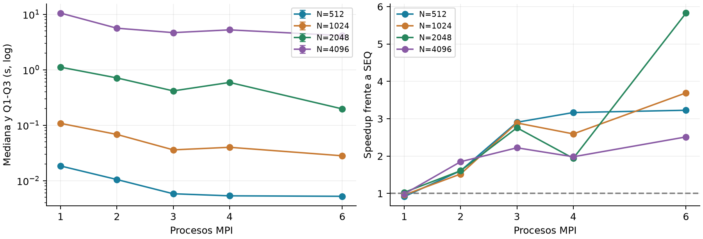
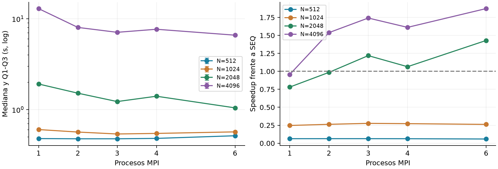
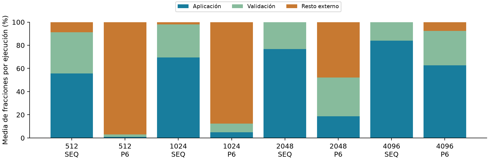

# Etapa 17: escalabilidad y comando completo

Pregunta: cuando el trabajo aumenta, ¿cómo cambia el rendimiento al pasar de uno a seis procesos y cuánto de la mejora sobrevive al medir el comando completo? Campaña del 28/09/2026, posterior al cruce formal. Análisis desde el paquete original, sin incorporar pilotos ni muestras de otras sesiones.

## Protocolo y evidencia

| Elemento | Verificación |
| --- | --- |
| Grilla | N=512,1024,2048,4096; SEQ y MPI P=1,2,3,4,6. |
| Muestras | 192 lanzamientos: 24 warmups y 168 útiles. Siete útiles por configuración. Cada interno tiene su externo y archivo .err. |
| Integridad y código | 592 archivos; 12 hashes de provenance coinciden. Las cinco fuentes candidatas coinciden con etapas previas. No hay manifiesto global de las mediciones. |
| Validez | 192 valid=1 y exit_code=0; residuos aceptables; fases coherentes; errores y logs de compilación vacíos. |
| Entorno | EPYC 7B12, GCC 13.3, Open MPI 4.1.6; cuota 6 CPUs y 24 GiB. Entorno fechado 16:40:52 UTC. |

## Dos relojes del mismo lanzamiento

application_s mide desde reserva hasta L completo en rango 0, con generación, factor y reunión. external_s proviene de measure_command.c: reloj monotónico antes de fork hasta waitpid. Incluye arranque del comando, MPI, validación, salida, liberación y cierre; excluye la escritura del CSV del cronómetro. El tiempo de cola o inicio del servicio no pertenece a este reloj.

Se verificó external_s >= application_s + validation_s. El resto se calcula por observación antes de resumirlo; no equivale a tiempo puro de arranque. Medianas y cuartiles inclusivos usan solo las siete rondas útiles. Q1-Q3 describen dispersión, no intervalos de confianza.

Los nombres de rondas están corregidos. El paquete no incluye el script de lanzamiento ni registros de posición temporal por ejecución: la rotación y la afinidad secuencial no pueden auditarse desde esos nombres. El entorno sí contiene un diagnóstico de binding P6, todos en el socket 0. Esta limitación no se confunde con un fallo numérico.

# Ganancia hasta obtener L

Figura 1. Tiempo de aplicación MPI y cociente mediana(SEQ)/mediana(MPI). Cada N usa su propio secuencial contemporáneo. P1 es la ruta MPI, no una copia del secuencial autónomo.

| N | SEQ s | P mínimo | MPI s | S | E % |
| --- | --- | --- | --- | --- | --- |
| 512 | 0.016851 | 6 | 0.005221 | 3.23 | 53.8 |
| 1024 | 0.103648 | 6 | 0.028074 | 3.69 | 61.5 |
| 2048 | 1.146293 | 6 | 0.196693 | 5.83 | 97.1 |
| 4096 | 10.391210 | 6 | 4.133791 | 2.51 | 41.9 |

## Interpretación

La curva no es monótona: utilizar más procesos no garantiza terminar antes. El mínimo entre configuraciones es descriptivo y requiere contexto; la eficiencia S/P no es utilización de CPU. Un valor cercano o superior al ideal lineal tampoco identifica por sí solo una causa como caché o balance.

En resumen.csv quedan los 24 grupos con sus medianas, cuartiles y cocientes, para ambos relojes y las fases. La grilla alcanza seis procesos bajo cuota; no permite extrapolar a 24 o 96 procesos ni a varios nodos.

## Pregunta siguiente

¿El mínimo del tiempo interno sigue siendo útil para quien espera que termine el comando? La validación secuencial y el costo de lanzar MPI pueden cambiar la respuesta, especialmente en los tamaños menores.

# Cuánto sobrevive en el reloj externo

Figura 2. Tiempo del comando y speedup externo. Las barras representan Q1-Q3 del tiempo; no se transfieren las ganancias del reloj interno al externo.

| N | SEQ ext s | P mínimo | MPI ext s | S externo |
| --- | --- | --- | --- | --- |
| 512 | 0.0302 | 3 | 0.4774 | 0.06 |
| 1024 | 0.1489 | 3 | 0.5392 | 0.28 |
| 2048 | 1.4950 | 6 | 1.0459 | 1.43 |
| 4096 | 12.3637 | 6 | 6.6011 | 1.87 |

## Una comparación explícita con P=6

| N | S aplicación | S externo | E externa % |
| --- | --- | --- | --- |
| 512 | 3.23 | 0.06 | 1.0 |
| 1024 | 3.69 | 0.26 | 4.4 |
| 2048 | 5.83 | 1.43 | 23.8 |
| 4096 | 2.51 | 1.87 | 31.2 |

S externo mayor que uno indica que el comando terminó antes por mediana. Un speedup externo menor no contradice la aceleración del kernel: mide una tarea más amplia. El primer tamaño de esta grilla que mejora no es un umbral universal ni necesariamente el mismo que el cruce N=192 de application_s.

# Costos del flujo y conclusión de escalabilidad

Figura 3. Media de las fracciones calculadas por lanzamiento; cada barra suma 100%. El resto externo combina inicialización, coordinación, cierre y otros costos. No es comunicación pura ni se obtiene restando medianas.

## Cuota observada

cpu.stat cambia en 5514 períodos, 197 con throttling adicional y 0.764111 s del contador throttled_usec. Las lecturas rodean toda la campaña y procesos auxiliares: no asignan ese costo a una configuración ni autorizan a restarlo de sus tiempos.

## Respuesta experimental

N=2048/P6: S interno=5.83; S externo=1.43. La comparación mide beneficio frente al programa secuencial propio en esta sesión. La validación permanece fuera del reloj interno y dentro del externo.

N=4096/P6: S interno=2.51; S externo=1.87. La comparación mide beneficio frente al programa secuencial propio en esta sesión. La validación permanece fuera del reloj interno y dentro del externo.

La campaña ya permite distinguir paralelismo del algoritmo y beneficio de extremo a extremo. No hace falta ampliar recursos para responder la pregunta planteada. Una repetición selectiva puede reforzar estabilidad, pero no es necesario investigar cada anomalía para cerrar un trabajo universitario.

Archivos: observaciones.csv, warmups.csv, resumen.csv, auditoria.json y el paquete intacto. Los hashes calculados al recibir el archivo permiten identificar esta copia; no reemplazan un manifiesto de mediciones que no se archivó. La siguiente etapa compara el secuencial propio con una biblioteca optimizada en un banco aparte.
