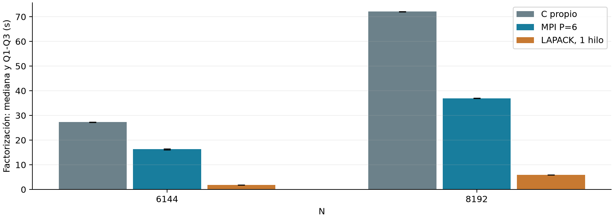
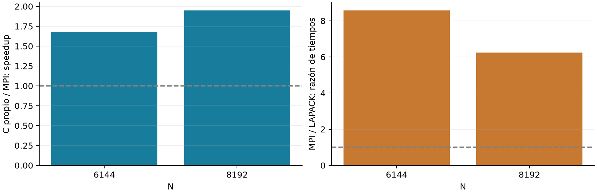

# Etapa 19: MPI frente a LAPACK en matrices grandes

Pregunta final: al crecer hasta N=6144 y N=8192, ¿MPI con seis procesos se acerca o supera a LAPACK/OpenBLAS con un hilo? Se analiza el paquete original del 28/09/2026 y se contrasta de forma independiente el ZIP de análisis recibido.

## Respuesta

MPI reduce el tiempo frente al C propio secuencial, pero no alcanza a LAPACK en ninguno de los dos tamaños. La razón MPI/LAPACK disminuye de 8,58 a 6,25: hay acercamiento relativo entre esos dos puntos, sin evidencia de un cruce futuro. La diferencia absoluta en segundos, en cambio, aumenta.

## Diseño y trazabilidad

| Aspecto | Evidencia |
| --- | --- |
| Métodos y tamaños | C propio, MPI P6 y LAPACK/OpenBLAS 1 hilo; N=6144 y 8192. |
| Repeticiones | Seis útiles por método y tamaño: 36 observaciones. Dos warmups MPI exportados; warmups own/LAPACK implementados dentro del banco, no exportados. |
| Integridad | 44 archivos regulares; 43 hashes del manifiesto verificados, excluido el propio manifiesto. |
| Continuidad | Los cinco fuentes candidatos coinciden con las etapas anteriores; compare_lapack.c coincide con la Etapa 18. |
| Entorno | EPYC 7B12, Open MPI 4.1.6, OpenBLAS 0.3.34; cuota de 6 CPUs y 24 GiB. Inicio 19:38:51 UTC; fin 20:05:20 UTC. |

## Qué hace comparable factor_s

El reloj principal abarca la fase que factoriza la misma familia de matrices SPD generadas con semilla 2026. En C/LAPACK es la llamada al kernel; en MPI es el intervalo del rango 0 alrededor del kernel distribuido, que incluye comunicaciones y esperas. No es un máximo reducido por fase ni una comparación de aritmética pura.

Generación y reunión quedan fuera de factor_s; los relojes secundarios tienen límites distintos. El banco C/LAPACK alterna métodos dentro de un proceso; MPI se lanza por separado. Por eso el cociente principal es descriptivo del costo de esa fase en los dos programas, no una prueba que aísle únicamente el efecto del paralelismo.

# Resultados de factorización y dispersión

Figura 1. Medianas y Q1-Q3 inclusivos, seis observaciones útiles por grupo. Barras de cuartiles descriptivas; no intervalos de confianza. Los warmups no se incluyen.

| N | Método | Q1 s | Mediana s | Q3 s | CV % |
| --- | --- | --- | --- | --- | --- |
| 6144 | own | 27.2602 | 27.2690 | 27.2713 | 0.027 |
| 6144 | mpi_p6 | 16.0909 | 16.2985 | 16.4927 | 1.424 |
| 6144 | lapack | 1.8987 | 1.8992 | 1.8996 | 0.076 |
| 8192 | own | 72.0020 | 72.0915 | 72.1250 | 0.131 |
| 8192 | mpi_p6 | 36.9214 | 36.9539 | 36.9942 | 0.211 |
| 8192 | lapack | 5.9129 | 5.9159 | 5.9181 | 0.065 |

CV usa desviación muestral dividida por la media. La variación MPI en N=6144 es mayor que la de los otros grupos, pero la separación respecto de LAPACK es amplia: incluso el menor tiempo MPI supera al mayor LAPACK en ambos tamaños. Esta observación no necesita transformarse en un test de significación para describir la diferencia de esta sesión.

## Corrección numérica

Las 12 mediciones MPI y los dos warmups registran valid=1. Las 24 filas own/LAPACK cumplen los controles exportados: residuo proyectado y diferencia de factor <=1e-12. Máximo residuo útil: 3.240e-15; máxima diferencia de factor: 8.866e-15. No se calcula residuo completo para estos tamaños.

El ZIP adjunto coincide con los seis grupos estadísticos y con las razones recalculadas desde los originales. No se utilizó su narrativa como sustituto de la verificación de datos.

# Acercamiento relativo, no cruce

Figura 2. Izquierda: valores mayores que uno indican mejora MPI frente al C propio. Derecha: valores mayores que uno indican que MPI tarda más que LAPACK. Los denominadores responden preguntas distintas.

| N | C / MPI | E MPI % | C / LAPACK | MPI / LAPACK |
| --- | --- | --- | --- | --- |
| 6144 | 1.673 | 27.9 | 14.359 | 8.582 |
| 8192 | 1.951 | 32.5 | 12.186 | 6.247 |

La eficiencia respecto del C propio es S/6: 27,9% y 32,5%. No equivale a utilización de CPU. LAPACK sigue por delante usando un hilo; no se ejecutó ScaLAPACK. La cuota de seis CPUs equivalentes no implica seis cores exclusivos.

La diferencia absoluta MPI menos LAPACK pasa de 14.399 s a 31.038 s. Por tanto, 'se acerca' solo es correcto en la razón relativa entre estos tamaños. Dos puntos no permiten extrapolar un tamaño donde MPI alcance a la biblioteca ni establecer una tendencia monótona.

## Interpretación y límite causal

Repartir el trabajo del kernel propio obtiene una mejora, pero no compensa la ventaja local de LAPACK/OpenBLAS en esta medición. La campaña no separa las contribuciones de localidad, vectorización, algoritmos internos de la biblioteca o comunicación. No hace falta identificar cada causa para responder la comparación experimental.

# Relojes secundarios y condiciones del entorno

| N | Método | Generación s | Reloj secundario | Mediana s |
| --- | --- | --- | --- | --- |
| 6144 | own | 0.4023 | total_s | 27.6713 |
| 6144 | mpi_p6 | 0.1322 | application_s | 16.6069 |
| 6144 | lapack | 0.4023 | total_s | 2.3017 |
| 8192 | own | 3.9806 | total_s | 76.0697 |
| 8192 | mpi_p6 | 0.0614 | application_s | 37.3368 |
| 8192 | lapack | 3.9786 | total_s | 9.8945 |

Estas medianas se presentan como contexto: no se construyen cocientes entre application_s y total_s. MPI application_s incluye reserva, generación, factorización y reunión/reconstrucción; total_s del banco own/LAPACK incluye reserva, generación y factor. Ninguno es el tiempo externo del comando. No se suman medianas para reconstruir totales.

## Salto en la generación

La generación secuencial pasa de aproximadamente 0,402 s a 3,98 s al cambiar N=6144 por N=8192. El salto es observado, pero su causa no se aisló. La hipótesis del stride de 65536 bytes por fila puede motivar trabajo futuro; no se presenta como explicación demostrada ni exige una nueva campaña para cerrar esta pregunta.

Su duración no se suma a factor_s. Sin embargo, la generación previa puede afectar caché y colocación de memoria al entrar al kernel: separar cronómetros no elimina toda influencia indirecta. Esa salvedad delimita la comparación, sin borrar la amplia diferencia observada.

## Cuota y procedencia

Entre lecturas de cpu.stat hubo 1676 períodos adicionales con throttling y 4.376492 s adicionales en throttled_usec. Son contadores de toda la sesión durante el intervalo, no tiempos perdidos atribuibles a una repetición. No se corrigen los resultados restando ese valor.

El paquete conserva fuentes, CSV y entorno, pero no script, binarios, códigos de salida del shell ni binding por ejecución. Los hashes de binarios mencionados en entorno.txt no pueden cotejarse sin esos binarios. Los .err MPI están vacíos y los de own/LAPACK informan threads=1. El estado numérico MPI es explícito; en own/LAPACK se verifican los residuos y diferencias exportados.

# Conclusión final de la comparación

## Respuesta a la pregunta planteada

En N=6144 y N=8192, con la sesión limitada a seis CPUs equivalentes, MPI P6 acelera el kernel propio 1,67 y 1,95 veces, respectivamente. Aun así, sus medianas de factorización son 8,58 y 6,25 veces las de LAPACK/OpenBLAS a un hilo. No se observó que MPI alcanzara ni superara a LAPACK en ninguno de los dos tamaños ensayados.

## Cómo completa el proyecto

La investigación muestra cuatro resultados complementarios: hay un tamaño mínimo ensayado donde el MPI propio empieza a compensar; la escalabilidad depende de N y P; el comando completo conserva menos ganancia que el reloj interno; y una biblioteca optimizada puede superar al kernel propio aun cuando este usa varios procesos. No se mezclan clocks ni referencias para obtener esas conclusiones.

La ganancia MPI es real respecto de la base propia medida, pero no demuestra superioridad frente a implementaciones especializadas. Esta distinción es un resultado valioso del proyecto, no una razón para seguir ampliando matrices hasta encontrar un resultado favorable.

## Mi recomendación de cierre

Con esta campaña, la pregunta final queda respondida para el alcance acordado. Recomiendo cerrar la experimentación y consolidar la conclusión general y la defensa. No es necesario probar 96 cores, implementar OpenMP o investigar en detalle el salto del generador. Se pueden mencionar como extensiones, sin convertirlas en requisitos del trabajo universitario.

El límite principal sigue siendo una familia de matrices SPD y una sesión bajo cuota compartida. La campaña no prueba comportamiento multinodo, ni ScaLAPACK, ni un cruce futuro. La diferencia relativa observada es amplia, aunque los bancos no comparten exactamente el mismo régimen de lanzamiento y calentamiento.

## Reproducibilidad

Se conservan los dos paquetes recibidos. observaciones.csv contiene las 36 mediciones útiles; warmups_mpi.csv conserva las dos filas descartadas. resumen_factor.csv, razones.csv, contexto.csv y auditoria_independiente.json se regeneran con desde_cero/docs/generar_informe_final_grande_cluster.py. El proceso no ejecuta código ni binarios recibidos. Estadísticas independientes coincidentes con el análisis adjunto. Documentación asistida por IA.
