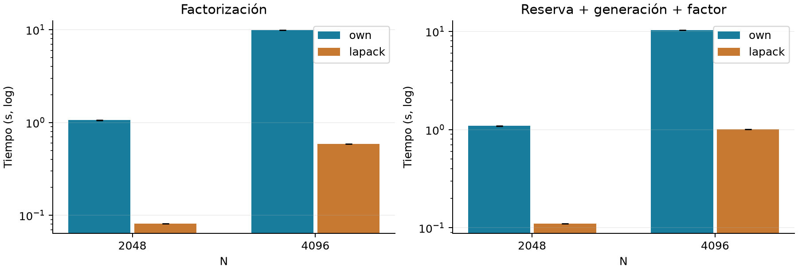

# Etapa 18: referencia LAPACK en el clúster

Pregunta: ¿cuánto margen de rendimiento local queda frente a una biblioteca numérica optimizada? Se comparan el kernel secuencial propio y LAPACKE_dpotrf_work, enlazado con OpenBLAS 0.3.34, dentro del mismo ejecutable y con la misma matriz. Es una comparación local de implementaciones; no es ScaLAPACK ni una prueba MPI de la biblioteca.

## Diseño comprobado en el código archivado

| Aspecto | Implementación |
| --- | --- |
| Tamaños principales | N=2048 y 4096; seis repeticiones por método y tamaño: 24 filas. Control N=512: otras 12 filas, separado. |
| Orden | Alternancia own/lapack y lapack/own; tres posiciones iniciales para cada método. Una ronda inicial por método sin exportar. |
| Hilos | openblas_set_num_threads(1) y comprobación por API. Los logs informan threads=1. OpenBLAS pthreads, no OpenMP añadido al candidato. |
| Entrada y salida | Matriz SPD con semilla 2026. Mismo generador; factor triangular inferior interpretado en row-major. |
| Validación | Ocho proyecciones, comparación con factor propio de referencia y pruebas pequeñas con residuo completo. |

## Qué mide cada campo

factor_s mide únicamente la llamada al kernel. total_s incluye reserva del arreglo y workspace, generación y factorización. Excluye preparar la matriz original/referencia del banco, validación y liberación. No existe aquí un reloj externo. Cada tamaño se ejecuta en un proceso con repeticiones internas, a diferencia de los lanzamientos nuevos de la campaña MPI.

LAPACK recibe la matriz simétrica como column-major y triángulo U: ese almacenamiento representa L en row-major. La variante _work evita la conversión row-major y el chequeo opcional de NaN de la interfaz. Se verifica un factor conocido en el test. La comparación conserva el mismo arreglo lógico sin cobrar una transposición adicional.

# Resultados: kernel y flujo completo del banco

Figura 1. Medianas y Q1-Q3 inclusivos, seis muestras por método. Escala logarítmica. El total se resume directamente, sin sumar medianas de fases. La mejora es own/LAPACK dentro de este banco.

| N | Reloj | Propio s | LAPACK s | Cociente |
| --- | --- | --- | --- | --- |
| 2048 | Factor | 1.060705 | 0.081292 | 13.05 |
| 2048 | Total | 1.089732 | 0.110383 | 9.87 |
| 4096 | Factor | 9.854616 | 0.589960 | 16.70 |
| 4096 | Total | 10.269754 | 1.006013 | 10.21 |

## Qué responde la comparación

La biblioteca reduce ampliamente el tiempo incluso con un único hilo. La mejora del total es menor que la del kernel porque la generación permanece en el flujo. Esto demuestra margen de optimización local del candidato; no demuestra que agregar procesos pueda alcanzar ese margen ni aísla qué parte corresponde a cada optimización de la biblioteca.

Los residuos y diferencias de factor pasan el criterio 1e-12 en las 24 filas. La diferencia normalizada máxima entre factores es aproximadamente 6,595e-15: resultados numéricamente consistentes no requieren igualdad bit a bit. Los tests pequeños figuran PASS.

# Auditoría y límites de la referencia

## Lo que contiene el paquete

Doce archivos: dos CSV principales, dos salidas .err, código C, headers, ejecutable, logs de prueba/compilación y entorno. Se verificaron los cuatro hashes de fuentes/ejecutable registrados en entorno.txt. No hay un manifiesto original que cubra todos los CSV; se conserva el tar íntegro y su SHA-256 de recepción.

Los archivos .err contienen el mensaje informativo de OpenBLAS threads=1, no un error de cálculo. El log de compilación contiene una advertencia -Wpedantic sobre _Float16 en openblas_config.h. Debe conservarse como advertencia de un encabezado de la biblioteca; no equivale a fallo del test ni autoriza a decir que compiló sin warnings.

El código acumula el estado de fallo y lo devuelve al finalizar. Las filas no incluyen valid ni el código de salida y el paquete no registra ese estado del shell. Las comprobaciones numéricas exportadas son satisfactorias y el log de tests dice PASS, pero no se inventa un exit_code para las corridas principales.

## Afinidad y condiciones

El límite de un hilo está comprobado por código y logs. El paquete LAPACK no conserva el comando de ejecución ni un registro de afinidad CPU: no se afirma que corriera fijado a CPU0. El banco alterna ambos métodos en el mismo proceso, lo que fortalece su comparación interna. El entorno registra EPYC 7B12 y bibliotecas conda-forge, fechado 17:25:42 UTC.

## Comparación con la etapa MPI

No se construye un speedup formal LAPACK/MPI mezclando estas campañas. Tienen distintos ejecutables, tratamiento de calentamiento, validaciones y sesiones de medición. La lectura conjunta sí es válida: nuestro MPI acelera una base propia y la biblioteca muestra que esa base conserva un margen local grande. Acelerar una implementación no demuestra que sea competitiva con una biblioteca especializada.

El control N=512 se conserva separado en control_n512.csv. No se suma a la muestra principal ni se usa como repetición independiente. Los seis resultados por método provienen del mismo lanzamiento; no son seis sesiones del clúster.

# Conclusión integrada y cierre universitario

## Tres respuestas complementarias

La Etapa 16 localizó el cruce de application_s: primera mejora clara ensayada en N=192/P3. La Etapa 17 midió cómo cambian las ganancias con N y P y cuánto sobrevive al comando completo. Esta Etapa 18 muestra el margen del kernel propio frente a LAPACK/OpenBLAS con un hilo. Cada resultado conserva su denominador y su reloj.

N=2048: LAPACK mejora el kernel propio 13.05 veces y el flujo interno del banco 9.87 veces. Es evidencia de rendimiento local, sin MPI en la biblioteca.

N=4096: LAPACK mejora el kernel propio 16.70 veces y el flujo interno del banco 10.21 veces. Es evidencia de rendimiento local, sin MPI en la biblioteca.

## Mi recomendación

Estas campañas cubren las preguntas centrales de un proyecto universitario: corrección, cruce, escalabilidad, costo completo y referencia optimizada. No abriría ahora una nueva implementación con OpenMP, bloques o distribución 2D ni una campaña hasta 96 cores. Priorizaría redactar la conclusión y preparar la defensa.

Si se desea una confirmación adicional, bastaría una sesión corta con SEQ y una o dos configuraciones MPI decisivas para N=2048/4096. Es una mejora de robustez, no una obligación de repetir todo. Guardar el script y la afinidad real solucionaría las principales carencias de trazabilidad detectadas.

## Límite que debe quedar explícito

La referencia aportada es LAPACK, no ScaLAPACK. Si la consigna docente exige explícitamente una biblioteca distribuida, esa parte sigue pendiente y requiere un experimento distinto. Si pide una referencia numérica optimizada, esta campaña ya aporta evidencia pertinente.

Conclusión defendible: el diseño MPI propio puede reducir el tiempo respecto de su versión secuencial cuando hay suficiente trabajo, pero los costos externos reducen la ganancia percibida y más procesos no siempre convienen. La comparación con LAPACK muestra que la eficiencia del kernel local importa tanto como repartir el trabajo. Estas observaciones se limitan a las matrices, grillas y entorno medidos.

Reproducción de ambas etapas: desde_cero/docs/generar_informes_escalabilidad_lapack_cluster.py. Paquetes originales preservados; CSV derivados y auditorías junto a cada campaña. Análisis y documentación con asistencia de IA.
